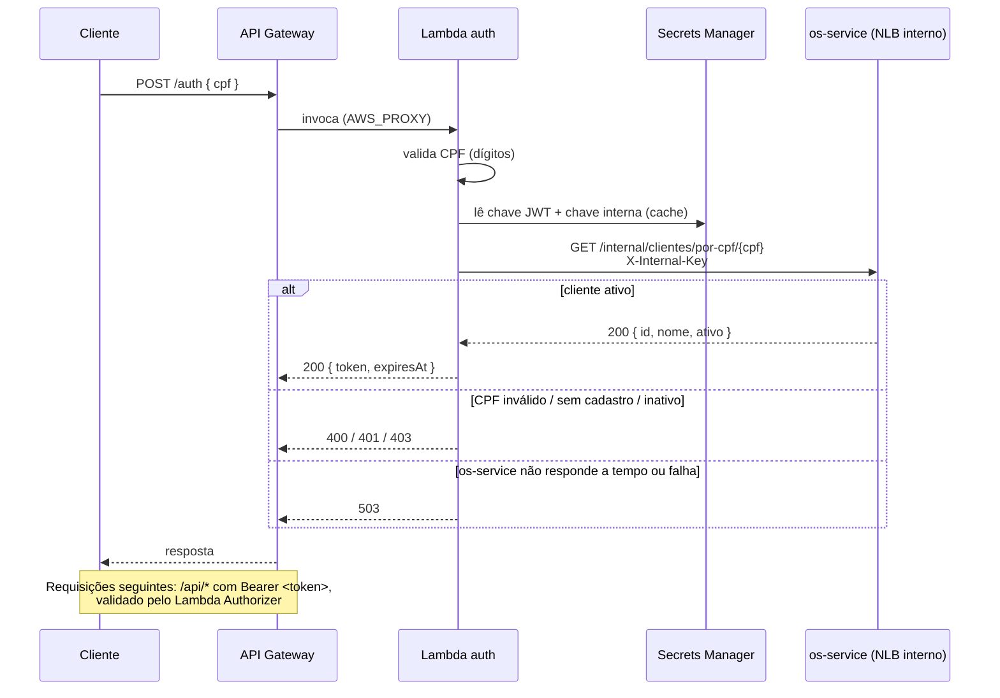

# oficina-lambda-auth

Function Serverless de **autenticação por CPF** da Oficina Mecânica (Tech Challenge
FIAP 15SOAT). Recebe um CPF, valida, pergunta ao **os-service** se o cliente existe
e devolve um **JWT** válido para consumir as APIs protegidas via API Gateway.

> Repositório 1 de 4. Os demais: `oficina-infra-k8s`, `oficina-infra-database`, `oficina-app`.
>
> Desde a Fase 4, a Lambda **não acessa banco**. O cadastro de clientes pertence ao
> `oficina-os-service`, e a Lambda o consulta por HTTP, num endpoint interno.

## Propósito

- Expor `POST /auth` (público) que autentica o cliente por CPF e emite um JWT (HS256).
- Prover um **Lambda Authorizer** que valida esse JWT nas rotas `/api/*` do API Gateway,
  protegendo o app hospedado no EKS.

## Tecnologias

- **Node.js 20 + TypeScript**, empacotado com **esbuild**.
- **jsonwebtoken** (JWT HS256), `fetch` nativo do Node (chamada ao os-service), **AWS SDK v3** (Secrets Manager).
- **AWS Lambda + API Gateway (HTTP API)**, provisionados com **Terraform**.
- Testes com **Vitest**. CI/CD com **GitHub Actions**.

## Arquitetura



A rota `/internal/*` do os-service **não** passa pelo API Gateway público. A Lambda a
alcança pela rede privada da VPC, e o security group dela só libera a saída para o NLB
interno (porta do os-service) e para HTTPS (Secrets Manager).

## Contrato da API

`POST /auth`

```jsonc
// Request
{ "cpf": "529.982.247-25" }
// 200 OK
{ "token": "eyJhbGciOiJIUzI1NiIs...", "expiresAt": "2026-09-06T19:00:00.000Z" }
```

| Status | Quando |
| --- | --- |
| `400` | CPF inválido ou corpo que não é JSON |
| `401` | Cliente não encontrado (o os-service respondeu 404) |
| `403` | Cliente inativo |
| `503` | os-service fora do ar, lento (passou de `OS_SERVICE_TIMEOUT_MS`), com erro 5xx ou recusando a chave interna. A causa exata vai para o log da Lambda. |

**Claims do JWT:** `sub` e `clienteId` (id do cliente no os-service), `cpf`, `name`, `role: "Cliente"`
e as formas longas de nome/role do ASP.NET. O `billing-service` usa o `clienteId` para
conferir que quem aprova um orçamento é o dono dele.

- **Coleção Postman/Insomnia:** [`docs/postman_collection.json`](docs/postman_collection.json).
- O Swagger das APIs protegidas fica no repositório do os-service.

## Configuração

| Variável de ambiente | Função | Uso |
| --- | --- | --- |
| `JWT_SECRET_ID` | auth e authorizer | Secret com a chave do JWT: `{"key":"..."}` |
| `JWT_ISSUER`, `JWT_AUDIENCE` | auth e authorizer | Padrão `OficinaMecanicaBackend` |
| `JWT_EXPIRES_MINUTES` | auth | Validade do token (padrão 60) |
| `OS_SERVICE_URL` | auth | URL base do os-service na rede privada, ex.: `http://<dns-do-nlb-interno>` |
| `INTERNAL_KEY_SECRET_ID` | auth | Secret com a chave do header `X-Internal-Key`: `{"key":"..."}`. Precisa ter o mesmo valor de `InternalApi__Key` no os-service. |
| `OS_SERVICE_TIMEOUT_MS` | auth | Tempo máximo de espera pelo os-service (padrão 3000) |

## Executar e testar localmente

```bash
npm ci
npm run typecheck
npm test          # Vitest — CPF, cliente HTTP do os-service, auth e authorizer
npm run build     # gera dist/handler.js e dist/authorizer.js
```

Os testes não dependem de AWS. O os-service é simulado por um servidor HTTP local de
verdade (`test/fakeOsService.ts`), então o `fetch` real é exercitado: header
`X-Internal-Key`, 404, 401, 5xx, corpo inválido, timeout e conexão recusada.

## Deploy

Automático via GitHub Actions ao dar merge em `homolog` ou `prod` (`.github/workflows/cd.yml`):
build → `dist/lambda.zip` → `terraform apply`. Variáveis/segredos necessários no repo:

| Tipo | Nome |
| --- | --- |
| Secret | `AWS_DEPLOY_ROLE_ARN`, `JWT_SECRET_ID` |
| Variable | `AWS_REGION`, `TF_STATE_BUCKET`, `TF_LOCK_TABLE`, `OS_SERVICE_URL`, `INTERNAL_KEY_SECRET_ID` |

O Terraform consome os outputs do `infra-k8s` (VPC, CIDR, subnets e NLB) via
`terraform_remote_state`. Não depende mais do `infra-database`.

## Deploy ativo

- **Endpoint (homolog):** _adicionar URL do API Gateway após o apply_
